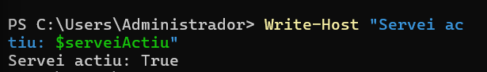

> **Nota**: Els exercicis/pràctiques t'han de servir per a familiarizar-te amb el llenguatge Powershell. Aprofita per a realitzar diverses proves i veure què passa. Documenta també aquestes proves i resultats.
# Tipus de dades

## 1. Identificar tipus

Crea les variables següents:
```powershell
$nom = "Servidor01"
$port = 443
$actiu = $true
$espai = 12.5
```
Consulta el tipus de cadascuna amb:
```powershell
.GetType()
```
Completa una taula com aquesta:

| Variable | Valor        | Tipus |
| -------- | ------------ | ----- |
| $nom     | `Servidor01` | String      |
| $port    | `443`        | int32       |
| $actiu   | $true        | boolean      |
| $espai   | `12.5`       | double       |
## 2. Número o text?

Executa:
```powershell
$a = 10
$b = 5

$a + $b
```
Després:
```powershell
$a = "10"
$b = "5"

$a + $b
```
Respon:

- Quin resultat obtens en cada cas?
> En el primer cas s'obte una suma entre la variable A i B i en el segon cas s'obte una concatenacio de la variable A i B 
- Per què no és el mateix?
> Perque en el primer cas les variables son de tipus numerics i en el segon cas les variables son de tipus text
Mostra després el contingut de cadascuna de les variables.


- Quin tipus tenen $a i $b en cada cas?
>En el primer cas son tipus enter i en el segon cas son tipus string
## 3. Canviar el tipus d'una variable

Executa:
```powershell
$valor = 100
```
Consulta:
```powershell
$valor.GetType()
```
Ara executa:
```powershell
$valor = "100"
```
i torna a consultar:
```powershell
$valor.GetType()
```
Respon:

**Ha canviat el valor? Ha canviat el tipus?**
> El valors en el 2 casos es el mateix pero el que si canvia es el tipus, en el primer casa es un int32 o un enter i en el segon cas pasa a ser un string
## 4. Tipus explícits

Executa:
```powershell
[int]$port = 443
```
Comprova el tipus:
```powershell
$port.GetType()
```
Ara prova:
```
[string]$portText = 443
```
Consulta també:
```powershell
$portText.GetType()
```
Respon:

**Tot i que visualment els dos valors semblen `443`, són del mateix tipus?**
> No son el mateix tipus el primer es un enter i el segon un string
## 5. Booleans

Crea:
```powershell
$serveiActiu = $true
$servidorDisponible = $false
```
Consulta els tipus.
>
Son de tipus boolean

Després mostra un missatge amb:
```
Write-Host "Servei actiu: $serveiActiu"
Write-Host "Servidor disponible: $servidorDisponible"
```


## 6. General

Crea variables per representar un servidor amb aquesta informació:
```
Nom: SRV-WEB01
Port: 443
Espai lliure: 125.7 GB
Actiu: True
```

Després:

1. mostra el valor de totes les variables;

2. consulta el tipus de cadascuna;

3. indica quin tipus de dada has utilitzat per cada valor.
> Per el nom he utilitzat un string, per el port un int32, per el espai he utilitzat un double i per l'estat he utilitzat un boolean